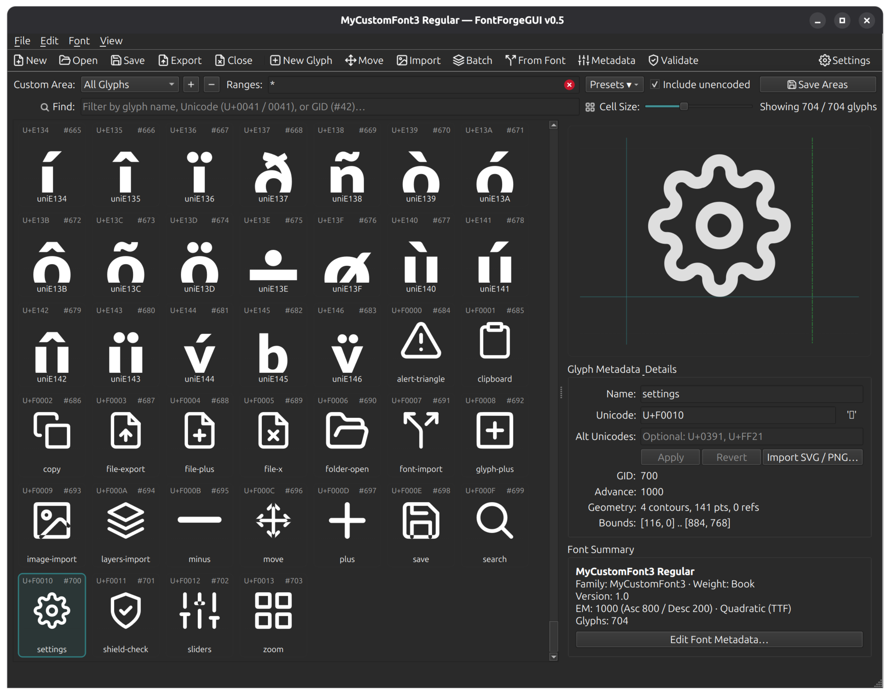
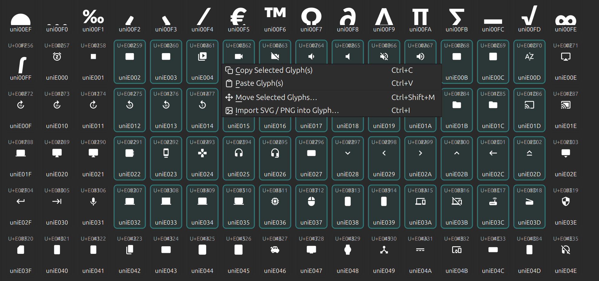
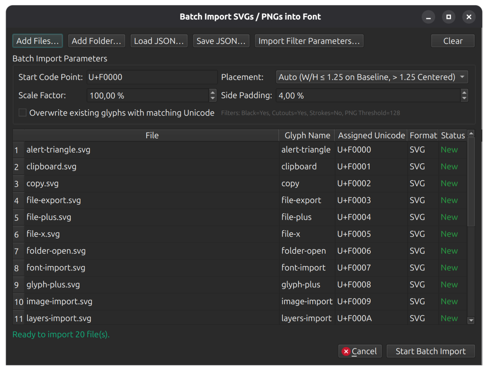
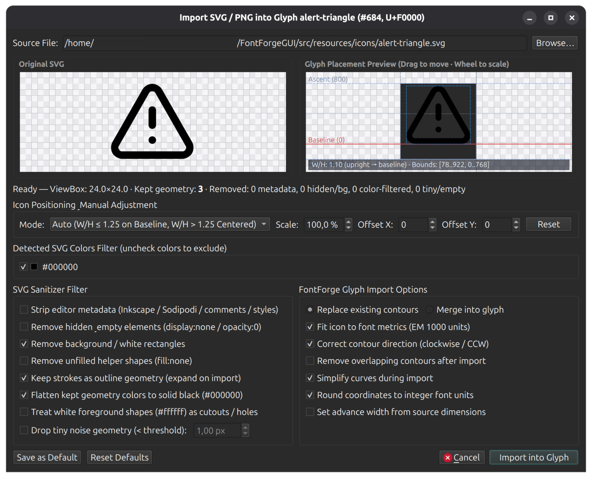
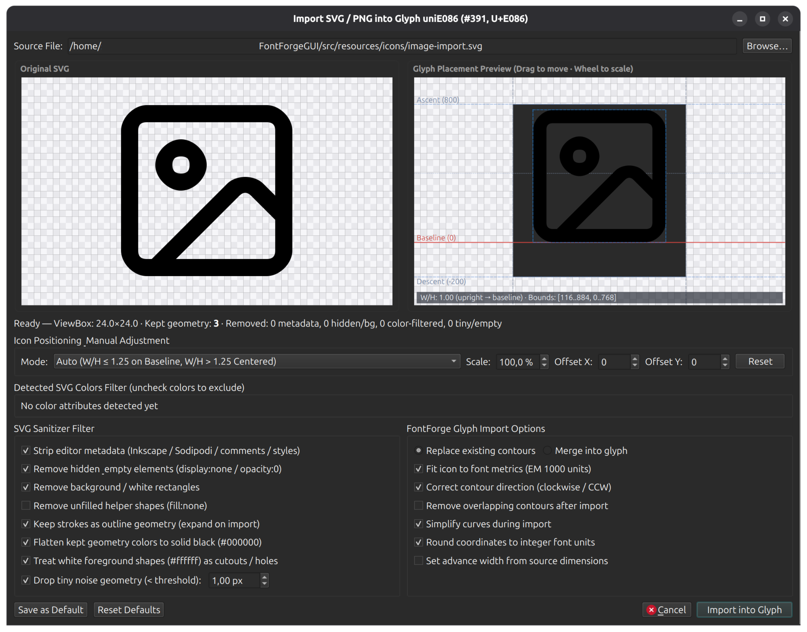
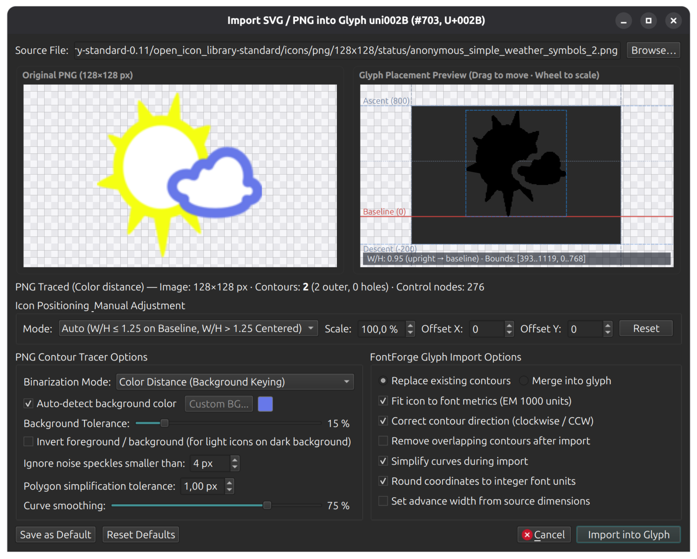
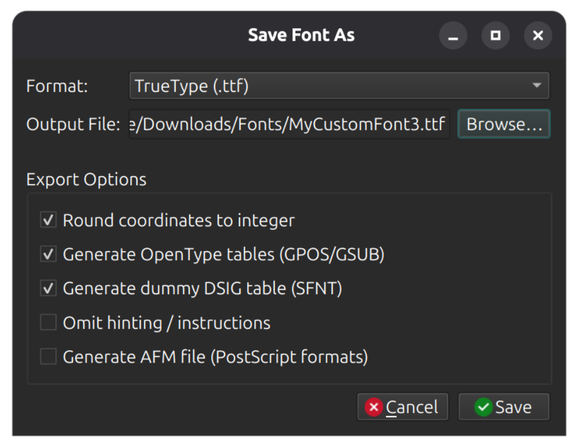
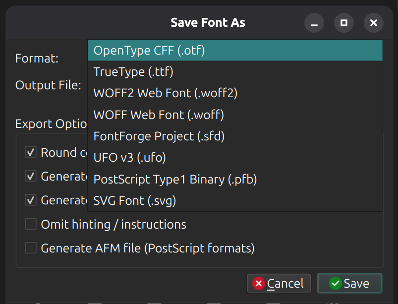

# FontForgeGUI

Modern cross-platform Qt 6 Widgets GUI for FontForge, built directly on headless `libfontforge` (`ENABLE_GUI=OFF`).



---

## Screenshots

| Main Window & Multi-Selection | Batch Import |
| :---: | :---: |
|  |  |

| SVG Import & Placement Preview | SVG Sanitizer & Color Filter |
| :---: | :---: |
|  |  |

| PNG Bitmap Tracing | Save As & Export Formats |
| :---: | :---: |
|  |  |

<details>
<summary>Supported Export & Save Formats</summary>



</details>

---

## Key Features

- **Font Creation & Editing**:
  - **Create New Font (`Ctrl+N`)** & **Create New Glyph (`Ctrl+Shift+N`)**: Initialize fonts or add new glyphs (`Name`, `Unicode`, `Alt Unicodes`, `Advance Width`) with optional immediate SVG/PNG import.
  - **Save In-Place (`Ctrl+S`)**, **Save As (`Ctrl+Shift+S`)**, & **Export (`Ctrl+E`)**: Persistent document path binding, dirty indicator (`*`), and last-directory memory across `.sfd`, `.ttf`, `.otf`, `.woff`, `.woff2`, `.ufo`, `.pfb`, `.svg`.
  - **Font & Glyph Metadata Editor**: Modify Font Family, PostScript Name, Weights, Copyright, and full SFNT `name` table. Edit glyph Unicode code points, names, and alternate unicodes inline.
  - **Validation Dock**: Real-time font integrity checks via FontForge's `SFValidate` with clickable issue navigation.

- **Glyph Grid, UI & Preferences**:
  - Fast vector-rendered glyph grid with Drag & Drop font loading, customizable cell zoom, and Shift/Ctrl multi-selection.
  - Unified `QGridLayout` filter & area bar with Unicode Range Filtering (Basic Latin, Latin-1, PUA, **SPUA-A `U+F0000–U+FFFFD`**, **SPUA-B `U+100000–U+10FFFD`**) and `.ffgui.json` sidecar persistence.
  - Theme-aware monochrome SVG icons (`Qt6::Svg`) and **Settings (`Ctrl+,`)** to configure toolbar display mode (*Icons and Text Beside/Under*, *Icons Only*, *Text Only*).

- **Glyph Relocation ("Move Glyphs" `Ctrl+Shift+M`)**:
  - Move multiple selected glyphs to a new starting code point (e.g. `U+F0000` or `0xF0000`) with debounced collision detection and overwrite/abort protection.

- **Advanced Vector & SVG Import**:
  - Interactive SVG Sanitizer: strips Inkscape/Sodipodi metadata and hidden shapes, excludes colors, supports stroke-only icons (`fill="none" stroke="currentColor"`), expands strokes, extracts `#ffffff` cutout holes, and cleans tiny noise.
  - Visual placement canvas: pan, zoom, and drag icon offsets with live FontForge baseline, ascent, and descent metrics.

- **Extended PNG & Bitmap Vector Tracing**:
  - Built-in in-memory contour tracer (`BitmapTracer`): Marching Squares directed edge extraction, Ramer–Douglas–Peucker simplification, and corner-preserving cubic Bézier smoothing.
  - **Four Binarization Modes**: Alpha / Luminance, Color Distance (Background Keying), Dominant Color Palette, and Edge Gradient (Sobel Filter), with persistent import defaults in `QSettings` (`Edit -> Import Preferences…`).

- **Font Merging & Inter-Process Clipboard**:
  - **Copy & Paste (`Ctrl+C` / `Ctrl+V`)** between FontForgeGUI windows and external vector apps (`image/svg+xml`, `application/x-fontforgegui-glyphs+json`).
  - **Import Glyphs from Font (`File -> Import Glyphs from Font…`)**: Merge glyphs with debounced collision analysis, range filtering, advance width copying, and automatic EM scaling.

- **Batch Import & Automation (GUI & CLI)**:
  - **Batch Import Dialog (`Ctrl+Shift+B`)** with JSON job definitions and headless CLI execution (`--headless`, `--batch-import`, `--merge-font`). See [CLI.md](CLI.md) for full documentation.

---

## Build & Run (Ubuntu / Linux)

1. Fetch upstream FontForge into `../FontForge`:

```bash
./scripts/fetch_fontforge.sh
```

2. Install dependencies and build + run tests with [`scripts/build_ubuntu.sh`](scripts/build_ubuntu.sh):

```bash
./scripts/build_ubuntu.sh --install-deps
./build/FontForgeGUI
```

You can also pass a font file on the command line (or drop one onto the empty glyph grid):

```bash
./build/FontForgeGUI ../FontForge/tests/fonts/Ambrosia.sfd
```

---

## Build & Run (Windows / MSYS2 UCRT64)

1. Install [MSYS2](https://www.msys2.org/) (default path `C:\msys64`).
2. Fetch FontForge into `..\FontForge` and build with [`scripts/build_windows.ps1`](scripts/build_windows.ps1) in PowerShell:

```powershell
# Fetch FontForge into ..\FontForge
.\scripts\fetch_fontforge.ps1

# First time: install MSYS2 UCRT64 packages, configure, build, and run CTest
.\scripts\build_windows.ps1 -InstallDeps

# Create standalone dist-win\ bundle (FontForgeGUI.exe + Qt6/MinGW/FontForge DLLs)
.\scripts\build_windows.ps1 -Package
```

---

## Command Line Usage

Complete CLI documentation is available in [CLI.md](CLI.md).

```bash
# 1. Open an existing font in the GUI
FontForgeGUI myfont.ttf

# 2. Merge glyphs from an icon font into a base font headlessly
FontForgeGUI -i Roboto-Regular.ttf \
             --merge-font material-icons.ttf \
             --source-range U+E000-U+E0FF \
             --target-start U+F000 \
             -o Roboto-Merged.ttf

# 3. Batch import images starting at U+F0000 into a new font headlessly
FontForgeGUI -o myicons.woff2 --import-images ./icons --start-unicode U+F0000 --headless
```

---

## Architecture & Documentation

- [src/README.md](src/README.md) — Source directory layout, threading model, FontForge C API isolation, and implementation details.
- [src/CONCEPT.md](src/CONCEPT.md) — Design decisions, milestone history, and roadmap.
- [CLI.md](CLI.md) — Command-line flags and JSON batch definition reference.

## License

Licensed under the **GNU General Public License v3.0 or later** (`GPL-3.0-or-later`), required by linking `libfontforge`. See [LICENSE.md](LICENSE.md) for the full license text.
